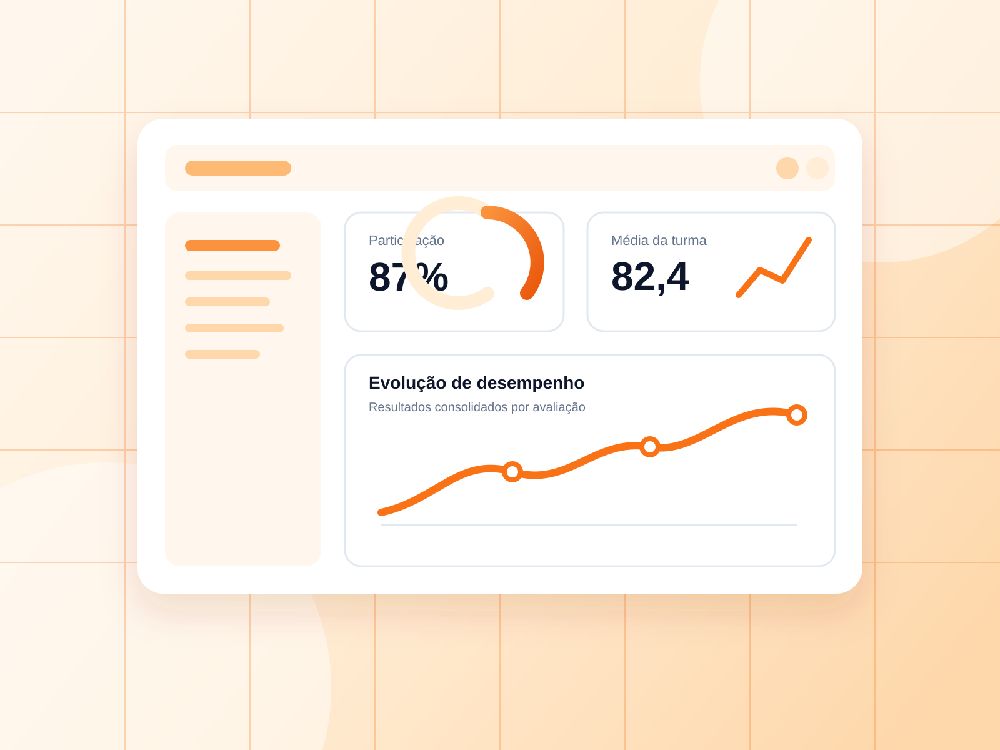

  

<h1 align="center">Nexo Avalia</h1>

  Plataforma educacional multi-tenant para criação de simulados, gestão de questões,
  geração pedagógica com IA e análise de desempenho.

  <strong>Dados que ensinam.</strong>

  
  
  
  
  
  

  <a href="#visão-geral">Visão geral</a> •
  <a href="#funcionalidades">Funcionalidades</a> •
  <a href="#arquitetura">Arquitetura</a> •
  <a href="#executando-localmente">Executar</a> •
  <a href="#segurança">Segurança</a>

Visão geral

O Nexo Avalia é uma aplicação web completa para instituições de ensino que precisam centralizar avaliações, questões, turmas, professores e indicadores pedagógicos em um único ambiente.

A plataforma possui duas experiências principais:

Área do aluno: simulados, histórico, resultados, ranking e evolução de desempenho.

Área de gestão: banco de questões, criação de simulados, geração com IA, turmas, usuários, relatórios, importações e permissões.

Este repositório foi preparado como um case técnico de portfólio baseado em uma solução utilizada em uma operação educacional real. Toda a identidade do cliente, nomes, e-mails, dados, credenciais e ativos privados foram removidos ou substituídos por conteúdo genérico.

O código público demonstra a arquitetura e as decisões técnicas do produto sem expor informações da implantação privada.

  

Problema resolvido

Instituições educacionais costumam distribuir seu processo de avaliação entre planilhas, formulários, arquivos e ferramentas desconectadas. Isso cria retrabalho, dificuldade de acompanhamento e pouca visibilidade sobre o aprendizado dos alunos.

O Nexo Avalia organiza esse fluxo em uma plataforma única:

Conteúdo da aula
      ↓
Geração ou cadastro de questões
      ↓
Revisão e banco reutilizável
      ↓
Criação e publicação de simulados
      ↓
Respostas e correção automática
      ↓
Ranking, histórico e análise pedagógica

Funcionalidades

Para alunos

Autenticação e primeiro acesso.

Dashboard com visão geral de desempenho.

Listagem de simulados disponíveis.

Execução de avaliações com salvamento de respostas.

Correção automática.

Resultado detalhado por questão.

Histórico de tentativas.

Ranking por turma, matéria e simulado.

Indicadores de evolução e desempenho.

Perfil e preferências do aluno.

Para professores

Acesso restrito às matérias atribuídas.

Restrição opcional por turma.

Banco de questões reutilizável.

Criação, edição, revisão e regeneração de questões.

Geração de questões com Inteligência Artificial.

Aprovação antes da entrada no banco definitivo.

Criação e acompanhamento de simulados.

Visualização de resultados apenas dentro do próprio escopo.

Para coordenação e administração

Gestão de alunos, professores, turmas e matérias.

Simulados com múltiplas turmas e matérias.

Publicação e controle de disponibilidade.

Importação de alunos por CSV ou XLSX.

Exportação de dados e relatórios.

Gestão de acessos e solicitações.

Auditoria de ações.

Dashboards e indicadores pedagógicos.

Configurações por organização.

Inteligência Artificial

Geração de questões a partir de textos e transcrições.

Registro de status do processamento.

Estimativa e acompanhamento de tokens.

Cálculo estimado de custo.

Fluxo de revisão humana.

Regeneração de questões.

Associação das questões à matéria correta.

Persistência das métricas do job de IA.

Arquitetura

flowchart LR
    A[Navegador] --> B[Next.js App Router]

    B --> C[Server Components]
    B --> D[Route Handlers]
    B --> E[Middleware]

    C --> F[Supabase Auth]
    D --> F

    C --> G[(PostgreSQL)]
    D --> G

    D --> H[Supabase Storage]
    D --> I[Google Gemini]
    D --> J[Resend]

    G --> K[RLS]
    G --> L[RPCs]
    G --> M[Schema app]

Decisões principais

Next.js App Router: interface, Server Components e endpoints no mesmo projeto.

Supabase Auth: autenticação e identidade dos usuários.

PostgreSQL: dados relacionais, constraints, índices, funções e RPCs.

Schema app: separação explícita do domínio da aplicação.

Multi-tenancy: isolamento por organization_id.

RLS: segurança aplicada diretamente no banco.

Backend guards: validação adicional para rotas que utilizam credenciais administrativas.

Zod: validação de payloads.

Server-side data access: chaves privilegiadas permanecem somente no servidor.

Jobs de IA: geração auditável e separada do fluxo de aprovação.

Escopo de professores

Os vínculos dos professores são armazenados em teacher_assignments.

organization_id → organização
membership_id   → professor
subject_id      → matéria autorizada
class_id        → turma autorizada

Quando class_id é NULL, o professor pode acessar todas as turmas da matéria atribuída. Isso não remove a limitação por matéria.

A proteção é aplicada em duas camadas:

Políticas e funções no PostgreSQL.

Validações e filtros no backend.

Mais detalhes em docs/ARCHITECTURE.md.

Stack

Camada

Tecnologias

Frontend

Next.js 15, React 19, TypeScript, Tailwind CSS

Componentes

Componentes próprios e Lucide React

Backend

Next.js Route Handlers e Server Components

Banco

PostgreSQL e schema app

Plataforma

Supabase Auth, Database e Storage

Segurança

RLS, validação de escopo, Zod e rate limiting

IA

Google Gemini

E-mail

Resend

Importação

CSV Parse e Read Excel File

Deploy

Vercel

Qualidade

ESLint, TypeScript e scripts próprios de validação

Estrutura do projeto

nexo-avalia/
├── docs/
│   └── ARCHITECTURE.md
├── public/
│   ├── brand/
│   └── subject-logos/
├── scripts/
│   ├── validate-priority-flows.mjs
│   ├── validate-public-repository.mjs
│   └── validate-teacher-subject-scope.mjs
├── src/
│   ├── app/
│   │   ├── (management)/
│   │   ├── (student)/
│   │   └── api/
│   ├── components/
│   ├── lib/
│   └── server/
├── supabase/
│   ├── examples/
│   └── migrations/
├── .env.example
├── PORTFOLIO.md
├── SECURITY.md
└── package.json

Executando localmente

Pré-requisitos

Node.js 20 ou superior.

npm.

Projeto próprio no Supabase.

Chave do Google Gemini para os recursos de IA.

Conta Resend apenas quando o envio de e-mail for utilizado.

1. Clone o projeto

git clone https://github.com/TWOmendes2/nexo-avalia.git
cd nexo-avalia

2. Instale as dependências

npm install

3. Configure o ambiente

No Windows PowerShell:

Copy-Item .env.example .env.local

No macOS ou Linux:

cp .env.example .env.local

Preencha o .env.local somente com credenciais de uma infraestrutura própria.

4. Prepare o banco

Execute os arquivos em supabase/migrations seguindo a ordem numérica.

A atribuição de professores depende dos usuários e matérias de cada instalação. Por isso, o exemplo fica fora das migrations automáticas:

supabase/examples/assign_teacher_subject_permissions.example.sql

Adapte os e-mails e as matérias antes de executá-lo.

5. Inicie o projeto

npm run dev

A aplicação ficará disponível em:

http://localhost:3000

Variáveis de ambiente

Variável

Finalidade

NEXT_PUBLIC_APP_URL

URL pública da aplicação

NEXT_PUBLIC_APP_NAME

Nome exibido na interface

NEXT_PUBLIC_DEFAULT_ORGANIZATION_ID

Organização padrão da instalação

SUPABASE_URL

URL do projeto Supabase

SUPABASE_ANON_KEY

Chave pública do Supabase

SUPABASE_SERVICE_ROLE_KEY

Chave exclusiva do backend

CPF_PEPPER

Segredo usado no tratamento de identificadores

GEMINI_API_KEY

Credencial da integração com IA

GEMINI_MODEL

Modelo utilizado na geração

RESEND_API_KEY

Credencial para envio de e-mails

PASSWORD_RESET_SECRET

Segredo do fluxo de recuperação

SESSION_COOKIE_SECURE

Controle de cookie seguro

MAX_IMPORT_FILE_MB

Limite dos arquivos de importação

Consulte .env.example para a lista completa.

Comandos disponíveis

Comando

Descrição

npm run dev

Inicia o ambiente de desenvolvimento

npm run build

Gera o build de produção

npm run start

Inicia o build de produção

npm run lint

Executa o ESLint

npm run typecheck

Valida os tipos TypeScript

npm run validate:priority

Valida os fluxos prioritários

npm run validate:teacher-scope

Valida o isolamento dos professores

npm run validate:public

Procura referências ou dados impróprios para o repositório público

npm run validate

Executa a validação completa

Antes de publicar uma alteração:

npm run validate
npm run build

Segurança

Este repositório não deve conter dados ou credenciais reais.

Boas práticas adotadas:

.env.local ignorado pelo Git.

SUPABASE_SERVICE_ROLE_KEY utilizada apenas no servidor.

Isolamento multiempresa por organization_id.

Row Level Security nas tabelas sensíveis.

Validação de papel, matéria e turma.

Rate limiting nos fluxos de autenticação e IA.

Schemas de entrada validados.

Exemplo genérico para atribuição de professores.

Script para auditoria do repositório público.

Nenhum dado real de aluno ou cliente incluído.

Execute a auditoria antes de cada publicação:

npm run validate:public

Leia também SECURITY.md.

Deploy na Vercel

Crie um novo projeto na Vercel.

Importe o repositório nexo-avalia.

Configure todas as variáveis de ambiente.

Utilize uma instância separada do Supabase.

Execute as migrations nessa nova instância.

Faça o deploy.

Nunca utilize as credenciais ou o banco da operação real em uma demonstração pública.

Roadmap

Testes end-to-end dos fluxos críticos.

Filas dedicadas para processamentos longos de IA.

Observabilidade com rastreamento de erros.

Métricas pedagógicas avançadas.

Relatórios comparativos por período.

Cobertura ampliada de testes automatizados.

Seeds totalmente fictícios para demonstração pública.

Sobre este case

O Nexo Avalia demonstra experiência prática com:

desenvolvimento Full Stack;

arquitetura multi-tenant;

autenticação e autorização;

modelagem de dados;

políticas RLS;

interfaces administrativas;

produtos educacionais;

integrações com IA;

importação e exportação;

segurança em aplicações SaaS;

publicação e manutenção de aplicações reais.

A edição pública possui identidade própria e dados fictícios. A implementação privada que originou o case permanece separada.

Mais detalhes sobre as decisões do projeto em PORTFOLIO.md.

Autor

Desenvolvido por Felipe Mendes.

GitHub: @TWOmendes2

Perfil profissional: github.com/TWOmendes2

Licença

Distribuído sob a licença MIT. Consulte LICENSE.

  <strong>Nexo Avalia — Dados que ensinam.</strong>

## Revisão técnica e evolução

[Arquitetura](docs/ARCHITECTURE.md) · [Segurança](docs/SECURITY.md) · [IA](docs/AI.md) · [Testes](docs/TESTING.md) · [Roadmap](docs/ROADMAP.md) · [ADR 0001](docs/adr/0001-preserve-modular-monolith.md) · [ADR 0002](docs/adr/0002-ai-as-untrusted-draft.md)

As verificações estáticas e unitárias não certificam uma implantação nem substituem testes de RLS e E2E.
